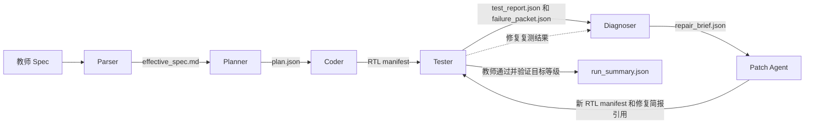

# EDA Agent 作业二实验记录

代码从用户提供的 `THU_AI_EDA_2026.zip` 单独解包。新运行使用原始课程 Spec、教师 TB 和已配置的 DeepSeek V4.1 Flash。教师目录的 25 个文件逐字节核对通过。

## 工作流



- **Parser 和 Planner** 保留教师规格正文，记录实现假设，冻结模块归属和端口。高级 CPU 的端口表在发给 Coder 前校验重复声明和格式。
- **Coder** 为 L1–L3 一次生成完整候选。每个模块仍写到计划指定的独立文件，文件数量、路径和模块归属在进入 Tester 前核验。
- **Tester** 运行原教师测试。失败证据包含首次检查失败、有限 trace、编译错误的原始文件位置和独立退休探针的观测。PPA 只对功能通过且层级符合要求的候选计算。复测单绑定原、新两份 manifest，并列出诊断指定反例在两份候选上的结果。
- **Diagnoser 和 Patch Agent** 分别位于 `ai_eda/agent/subagents/diagnoser.py` 和 `ai_eda/agent/subagents/patch_agent.py`。前者提出一个可验证的假设，后者只修改简报指定的文件。补丁使用唯一锚点或有范围限制的完整文件替换。重新测试发现退化时，保留此前选中的快照。
- **交接记录** 包含 schema 版本、项目、运行编号、轮次、时间、文件引用、字节数和 SHA-256。每次复测使用指定 manifest 的不可变快照。最终结果引用对应的报告和 manifest。

## 复现

在工程根目录配置 `DEEPSEEK_API_KEY`，并让 `iverilog` 和 `vvp` 位于 `PATH`。使用现有 Python 环境执行：

```sh
python scripts/run_cpu_agent.py --level 1 --max-calls 8 --max-repairs 2
python -m unittest discover -s checks -v
```

将 `--level` 改为 `2` 或 `3` 可从对应教师规格开始独立生成。可通过 `EDA_MODEL` 和 `EDA_BASE_URL` 选择已有模型和网关。每次运行在 `runs/agent/<run_id>/run_summary.json` 保留预算、调用参数、耗时、教师测试和来源。网关未返回 usage 时，计费 token 字段留空。

## L1 对照

两组从空白生成。旧版数字来自先前保存的汇总。提醒隔离前已查阅旧交接记录，启动过一次历史样本复放。该复放已移出新工程。独立实跑和同输入上下文对照使用课程原版和本轮新生成候选。

| 运行 | 调用 | 墙钟 | 教师结果 |
| --- | ---: | ---: | --- |
| 上一版历史同预算运行 | 8 | 525.0 s | 进入仿真，未通过。最终候选记录 19 项等待停机超时 |
| 本轮第一次 | 7 | 198.8 s | 进入仿真，主机 20 秒上限截断。原样重测完整结束，20 条失败，其中 19 项等待停机超时 |
| 本轮第二次 | 7 | 186.4 s | 停在编译。查明计划重复端口和顶层实例重复绑定 |
| 本轮第三次 | 7 | 283.5 s | 进入仿真，保留首版。该候选有 210 条失败、8 项等待停机超时 |
| 本轮第四次 | 7 | 215.4 s | 首版 55 条失败；一次有效补丁后保留 51 条，7 项等待停机超时 |

第一轮的独立探针确认 `addi` 正确退休，ECALL 进入 EX 后与 `halt_pending` 触发的 flush 同拍，未到达 MEM。教师 TB 重测只调整主机等待时间，保留原测试内的周期上限。旧版和本轮框架的本地测试路径不同，耗时用于记录各次运行，稳定性和性能需要多次通过后比较。

四次独立运行编号依次为 `agent-20261111T020321395287`、`agent-20261111T020913167337`、`agent-20261111T021411115393` 和 `agent-20261111T022354434243`。每次记录在 `runs/agent/<run_id>/`。

第三轮上，补丁一的断言数从 210 降到 122，同时等待停机超时从 8 项增到 13 项，因此回退。补丁二未改善教师结果。独立 I-cache 探针进一步确认，冷缺失请求地址 `0x100`、`0x104`、`0x108` 均错误返回 `0x10c` 的数据。新探针将这四个独立请求的期望与实际响应交给 Diagnoser。

### 同一候选的上下文对照

用第三轮首版的新候选和同一份失败报告构造课程原版 Modifier 请求。原版的系统提示加用户输入共 105,971 字符，包含全部 10 个 RTL 文件。新版实际调用中，Diagnoser 为 7,733 字符，Patch Agent 为 48,529 字符，合计 56,262 字符，减少约 46.9%。Patch Agent 接收 4 个 RTL 文件。字符数是上下文测量值，网关的计费 token 仍缺失。记录位于 `runs/clean-prompt-comparison/comparison.json`。


第四轮候选的 I-cache 四个冷缺失字偏移都正确。D-cache 独立复测显示，修复前半字写和字节写的外部地址均被对齐，修复后均保留原低两位。冷 load 与依赖加法的整机探针则发现，外部总线已正确返回 41，退休流却跳过 PC 4 的 load，并重复退休 PC 8 的 addi。整机探针给下一轮提供这一对可区分的证据。


## L2 和 L3 首轮

| 层级 | 独立运行编号 | 教师结果 |
| --- | --- | --- |
| L2 | `agent-20261111T022936490282` | 7 次调用，390.7 秒。补丁推进到完整教师仿真，仍有 26 条失败 |
| L3 | `agent-20261111T023933205366` | 7 次调用，217.4 秒。补丁修复外部总线多驱动后进入仿真，仍有 32 条失败 |

L2 首次补丁让 hazard 模块能编译，同时留下未连接的时钟和复位。额外 Icarus 检查复现两个悬空端口。Tester 已增加相同检查，结果会标注为框架预检并携带实际实例和源位置。

L3 第一份候选的顶层总线多驱动已由第一份补丁解决。第二次诊断受上一轮复测单的旧编译错误叙述干扰，回到了已完成的阶段。现在简报校验 `stage` 必须与当前测试报告一致，历史只传被回退候选的可测差异。L2 执行探针观察条件分支训练，L3 执行探针观察待访存期间的独立 ALU 旁路和按序退休。


## 最新定向实验

在第四轮自己生成的已选候选上复跑，编号 `agent-20261111T024433161757`。第一次补丁只改 `mem_stage.sv`，恢复了 PC 4 的 load 退休、x2=41 和退出码 42。教师失败数从 51 降到 37，但 PC 8 仍退休两次，且 `t07_load_use` 和 `t11_halt` 新增停机超时，最终保留 51 条失败的已选候选。

编排器允许从探针有实测改善的未采纳候选继续诊断。每轮均受相同调用预算和补丁轮数约束。该实验的验收仍以之前已选候选为基线，改善和新增失败分别存入裁决。下一步用此入口复核 load-use 保持与退休去重，再从空白独立复验。当前 L1、L2、L3 独立通过次数均为 0。


### 逐拍诊断与补丁展开检查

Tester 现在记录接受取指请求的地址，以及流水线、发射和提交信号在时钟沿更新后的值。I-cache 探针在请求接受后改变空闲输入地址，检查响应仍属于原请求。Patch Agent 在交付仿真阶段补丁前用 Icarus 展开，能在本轮把诊断定位到 RTL 源文件行号并重试。回退候选可在目标探针和所有可比较探针合计改善时继续诊断，教师验收仍使用已选基线。

- L1 定向运行 `agent-20261111T030029780785` 重放本工程之前由模型产生的 MEM 补丁，后续调用使用当前证据。首次补丁恢复 load 数据和退出码，但 PC 8 重复退休且新增停机超时。已选结果保留 51 条失败。补丁展开预检在此轮捕获了未声明信号。
- L2 定向运行 `agent-20261111T025915092281` 确认取指请求 0 的冷缺失曾返回地址 4 的指令。两份补丁先后通过 I-cache 选字和 D-cache 存后读探针。剩余首条指令 PC 标错和新增停机超时触发回退。
- L3 定向运行 `agent-20261111T030933725116` 的 I-cache 选字补丁通过局部探针。对原候选的逐拍观测有两拍 `issue_valid=1`、`issue_ready=1`，前 36 拍的 `complete_valid` 和 `commit_valid` 均为零，顶层完成输入只连接 LSU。此观测为下一轮完成路径修复的依据。

这些定向实验来自本工程本轮生成的候选。原教师测试仍是最终验收入口，三个等级仍待独立通过。


### 跨模块连接与下一轮冻结规划

- L1 定向复跑 `agent-20261111T031707287451`。在已恢复 load 数据的候选上，PC 8 重复退休。逐拍证据现在同时列出未处于 hold 的重复槽位和顶层实例实际绑定。该样本最早出现在 ID/EX 的第 11、12 拍；WB 在第 19、20 拍收到两个 PC 8。修复应对齐 IF/ID 与 ID/EX 的接收条件。把 WB 改成等待 valid 拉低会吞掉连续到达的不同指令。
- L2 定向复跑 `agent-20261111T031459945782`。以同一候选为基线，已选教师断言从 54,079 条降到 7,314 条。候选仍可能给 PC 0 标上地址 4 的指令，预测探针尚未观察到分支解析。Coder 的前端约束现在要求接受请求时绑定 PC、预测与 epoch，并为每笔取指选择唯一一次 PC 推进。
- L3 定向复跑 `agent-20261111T031356335810`。补丁让最小程序从零退休推进到整数指令退休和 ECALL 停机，退出码仍为零，原教师测试仍有 32 条失败。旧候选的 IQ 与 LSU 分配标签同接常量 0，LSU 的两个操作数也接常量。对 L3 新规划选定 ROB 作为分配标签的唯一来源，并在生成阶段检查 IQ、LSU 的实例绑定是否来自 ROB。允许直接连接或简单连续赋值别名。接线校验失败时，Coder 在现有预算内可仅重做顶层。
- 补丁继续保留教师顶层接口。若实际 RTL 遗漏 Planner 已冻结的内部端口，可补齐并连好实例，随后进行展开和原教师测试。L3 第一次空白试跑 `agent-20261111T032004094497` 已在生成校验阶段检出 Rename 的伪分配标签，没有进入教师仿真。

### 跨模块握手和断点复测

Tester 现在分别记录取指请求接受、I-cache 响应、组合环、无驱动网络和 Icarus 的常量位宽截断警告。失败包把警告定位到 RTL 文件行。Diagnoser 可以用独立探针和源码共同确认根因，再给 Patch Agent 指定可改文件及复测目标。续跑时，`--resume-from RUN_ID` 校验历史快照并分别重测教师验收基线和已有探针改善的候选。失败的后续尝试会保留此前的诊断候选，已选版本仍按教师结果更新。

- L1 的 `agent-20261111T074400847590` 保留 51 条教师失败的基线。诊断候选恢复 load 值 41 和退出码 42，教师失败 37 条，出现了额外停机超时且 PC `0x8` 仍重复退休。第 11、12 拍的 IF/ID 保持和 ID/EX 重复接收已纳入修复简报。
- L2 的 `agent-20261111T074043559887` 曾把组合环消掉，但把 IF 请求写成依赖 `!ready`，请求因此无法接受。另一个候选恢复首笔请求接受且没有组合环，教师失败仍为 25 条。后续 `agent-20261111T074817610342` 中，Tester 将 `2'd4` 截断的警告定位到 I-cache 的 refill 请求条件。只改 I-cache 的补丁通过四个选字探针，整机分支探针前 36 拍观察到 23 次退休。该候选的教师失败记录增至 1,104,735 条，未采纳为验收基线。
- L3 的 `agent-20261111T073006026619` 将已选结果从 34 条教师失败降到 33 条。后续 `agent-20261111T074228366344` 的诊断候选让退休探针观察到 8 次退休，其中有重复 PC，ECALL 未退休，教师失败仍为 33 条。

### L1 定向通过原教师测试

从本工程的模型快照 `agent-20261111T074400847590` 第 2 轮复制到独立实验目录。手工实验用相同的下游 hold 控制 ID/EX 与 EX/MEM，在 load-use 时单独插入 bubble，并给 IF/ID 和 MEM 请求明确的消费及释放条件。依赖 load 探针恢复四条按序退休、x2=41、退出码 42，教师失败降到 10 条。剩余超时的共同原因是 IF 的 `redirect_pc` 接到了 hazard 模块的常量 0，EX 计算的目标没有送到 IF。修正顶层连接后原教师测试通过。加入 epoch 检查后再次通过，教师验证等级为 1，0 条失败。报告位于 `runs/l1-transfer-experiment-epoch/test_report.json`。这是手工定向候选的验收记录。

将实验确认的流水线传输条件写入 Coder 指令和 Diagnoser 修复简报。`agent-20261111T080308468568` 的模型补丁将候选从 37 条降到 15 条教师失败，并通过依赖 load 探针，仍遗留分支目标接线。新增 L1 暖 I-cache 回跳探针，独立测量循环、ECALL 与退出码。探针失败且源码证明 IF 由常量驱动时，Diagnoser 直接限定顶层接线和 hazard 文件，复测目标为该回跳探针。

`agent-20261111T080719143370` 的模型返回了一份有实际修改的顶层和一份内容相同的 hazard 文件，原补丁解析器拒收整份结果。现在校验所有文件的范围和大小，只保存实际变化，整份无变化仍判失败。以相同 RTL 快照和原模型响应复跑的 `agent-20261111T081147875052` 通过回跳探针，但教师测试出现新的退休 PC 不匹配，验收回退。另一次空白独立运行 `agent-20261111T080855381594` 从 160 条降到 31 条教师失败，尚未通过。后续简报将 IF 单槽应答、MEM 释放和重定向的时序写成了可直接落实的约束。

`agent-20261111T081425848795` 在补丁输出截断后停止。Patch Agent 现会在调用预算内改用短锚点编辑重试，并在同一 RTL 快照上复测。`agent-20261111T081917098448` 的 MEM 补丁把 37 条教师失败降到 15 条，两个候选触发相同的额外停机超时。编排器现允许从相对前一个诊断候选确有教师改善的版本继续，正式验收基线仍按原规则选择。新加跨 I-cache 行的 JAL 探针验证四个正确 PC 和指令字、错误路径 ECALL 被冲刷及退出码 7，已在手工通过候选和存在接线缺陷的候选上确认探针判定。

### L1 Agent 续跑通过

`agent-20261111T083451890211` 的 Patch Agent 先接回 EX 跳转目标，再修复 IF 的请求与响应槽，教师测试仅剩 `t11_halt`。新探针观测到冷 load 已退休，随后 ECALL 未进入退休流。源码确认顶层在 IF/ID 看到 ECALL 时就设置 halt-pending，当时 ID/EX 仍可能等待更老的访存。修复简报将范围限定为顶层，并要求 halt-pending 和 epoch 使用同一 ECALL 接受条件。

`agent-20261111T083823332822` 从该诊断候选续跑。Patch Agent 一次模型调用生成补丁，Tester 报告 L1 验证等级 1，0 条失败。`base`、`cache` 与 `performance_correctness` 均通过。报告和选中的 10 个 RTL 文件通过 manifest 哈希核验。此结果来自本工程模型生成和修补的续跑。空白独立复现通过 `runs/l1-independent-after-automated-pass.log` 跟踪。

### 空白生成的级间寄存器约束

独立运行 `agent-20261111T084033619971` 的首版把 ID/EX 与 EX/MEM 做成组合直通，形成贯穿 WB 前递的组合环。该候选从教师仿真超时推进到完整仿真，最终仍有 76 条失败。现在 L1/L2 的 Planner 分别指定 ID、EX、MEM 持有 ID/EX、EX/MEM、MEM/WB 寄存器，并明确 hold、flush 和有效载荷端口。Coder 与 Patch Agent 检查 `valid`、PC、指令字来自上升沿更新的状态，检查顶层控制连线。已用同一检查接受此前通过的 RTL，并检出独立首版的组合直通。`agent-20261111T085048016419` 的规划因 MEM 输入与输出重名失败，Planner 新约束明确 MEM 读取自有寄存器，并用独立端口接收 WB 选择后的前递值。

Tester 的完整报告继续作为验收和交接 artifact。运行事件只保存有限预览，前端读取 handoff 时按预览长度读取文件。用此前 L2 的 210,501,940 字节报告实测，事件预览为 73,042 字节，原始 1,104,735 条失败仍可在报告中查阅。

最新空白运行 `agent-20261111T085621705596` 已冻结新规划。三个级间寄存器的控制和有效载荷端口齐全，MEM 的两个写回寄存器端口各只声明一次。运行日志为 `runs/l1-independent-boundary-ownership.log`。

### L1 取指等待、访存完成与 EX 操作数

新规划的首版 RTL 通过级间寄存器检查，随后教师仿真发现 I-cache 请求经过 hazard 的 stall 回到自身的 valid 门控，形成组合环。`agent-20261111T090220484069` 的 Agent 补丁切断环、接通两条前递数据线、修复 I-cache 冷缺失选字，教师仿真得以结束。`agent-20261111T090645620593` 修复 MEM 过早释放以及 ECALL 错用调试读值，依赖 load 恢复正确退休和退出，诊断候选仍有 2,948 条教师失败。

在相同空白首版上进行的手工隔离实验确认，EX 的第二个 ALU 操作数在即时数选择之后不能再用于 store 数据或条件比较。修复这一点后，教师测试剩 127 条失败，集中在取指等待稳定性和缓存复用。保留重定向时已在途的 refill 后只剩缓存复用一项。限制 IF/ID 尚有未消费指令时的下一笔请求后，教师报告为 L1、0 条失败。该报告是手工隔离实验，位于 `runs/l1-clocked-boundaries-isolation-reuse/test_report.json`。

Tester 新增跨行回跳加外存等待的探针，分别记录地址/valid 变化和 refill 次数。手工修复前测到 15 次等待期间请求变化；保住在途 refill 后变化归零但读了 68 拍；对齐 IF 请求与 IF/ID 消费后读回落到 8 拍。Agent 续跑从模型自己的诊断候选开始，运行日志为 `runs/l1-branch-operands-and-refill.log`。

`agent-20261111T091354911346` 的 Agent 补丁将教师失败从 2,948 条降到 127 条，再降到 1 条。编排器保留通过更多教师用例的快照，避免续跑取用未通过目标探针且重新引入教师失败的版本。`agent-20261111T092323661915` 从剩余 1 条失败的模型快照续跑，只修改 IF 请求使能。取指等待探针通过，教师测试验证等级 L1、0 条失败。通过候选的 10 个 RTL 文件通过 manifest 核验。整条链从空白运行 `agent-20261111T085621705596` 开始，经数次断点续跑，使用的是模型生成的快照。独立的手工隔离结果用于验证假设。

### 工作台 L1 一键运行

启动本工程的工作台后，访问 `/?project=rv32i5_cache` 可直接打开 Agent 页的 L1 项目。点击 Run Agent 会新建运行目录，依次解析课程 Spec、规划、生成 RTL、测试并在同一个后台任务中执行诊断和补丁。L1 使用固定课程规格，因此 Parser 将歧义记录为实现假设。对输出截断、无效规划、无效补丁的重试均记录为独立步骤。L1 默认最多 16 轮修补，可在运行参数中调整。页面以原始教师测试报告的验证等级为准。

首个浏览器验收 `agent-20261111T123002176426` 从空白启动，无用户补充或续跑，进行了 40 次模型调用、17 次 Tester 检查。取指修复后一度达到 27 项失败，最终采纳的快照消除了部分停机超时，仍有 65 项断言失败，网页显示 FAIL。该结果用于定位请求 PC 被覆盖、分支重定向目标接线、D-cache refill 丢失待处理请求等问题。

第二个浏览器验收 `agent-20261111T124347613365` 从空白目录启动，只点击一次 Run Agent。经过 33 次模型调用、15 次 Tester 检查，用时 563.988 秒。没有人工补充、修改该次 RTL 或从历史运行续跑。最后一份报告 `tester-15/test_report.json` 记录教师验证等级 L1，0 项失败，页面显示 PASS · L1。选中的 10 个 RTL 文件均通过 manifest 核验。另一次通过同一网页 API 启动的空白运行 `agent-20261111T123931447115` 也获得教师验证等级 L1，0 项失败。重构前后核对了课程原始 ZIP 的 25 个任务文件，全部逐字节一致。

### L1 重复性验收和补充边界

每批从同一份工程快照发起五个新工作台任务，参数和预算固定。成功须满足该任务从空白生成、教师报告验证等级为 L1、零断言失败。预算耗尽、模型错误以及仿真失败都计入分母。历史通过快照、手工隔离实验、断点续跑均不计入本次成功率。运行台账分别为 `runs/l1-web-reliability-20261111-cohort-01.json` 和 `runs/l1-web-reliability-20261111-cohort-02.json`。

边界补充检查让 ECALL 紧跟一次冷 load，分别对 I/D 总线每笔访问加入 3/12 个等待周期，核对请求信号保持、三条按序退休、退出值和停机时取指地址。两份历史教师通过快照均满足补充检查。一份中间快照虽已正确退出，但停机阶段有 2 次地址或 valid 稳定性违规，证明新观测可以区分此故障。L2 的补充程序让同一 JALR 指令连续解析到两个不同目标，同时覆盖同 BTB 索引的不同 PC、错误路径 store 和 ECALL。先用已通过的 L1 快照核对了程序的十条退休指令和退出值，预测解析与误预测行为须在 L2 设计上复验。

基线五次中通过 0 次。最终选中版本的失败数依次为 27、852、3647、90、203668。改进批次与基线使用独立快照，新增停机等待探针、RTL 交接诊断及 20 轮修补预算。第二批的完整统计保存在独立台账。

改进批次五次中通过 1 次。最终选中版本的失败数依次为 2635、1871、0、251009、212811。通过运行 `agent-20261111T131738256905` 从空白启动，经 46 次模型调用和 14 次 Tester 检查，耗时 732.679 秒。原始教师测试验证等级为 L1，补充探针也观察到三次按序退休、正确退出值和两条总线等待期间零变化。两批均未达到 4/5。

之后新增了对 Cache 请求与顶层总线延迟不一致的诊断。在两份失败快照上，外部地址寄存器晚于 Cache 内部请求一拍，而 raw ready 直达 Cache，导致零等待时 PC 0 和 PC 4 取到同一个指令字。该诊断及 IF/ID ready 方向约束属于后续修正，尚无该版本的五次重复性数据。

### L2 教师测试与预测边界验收

空白启动 `agent-20261111T132344480018` 进入完整教师仿真。后续用同一工程自己生成的快照自动续跑，选中候选的失败数从 1485 降至 83、16、0。主要修正包括分支不冲刷自己的 EX/MEM 结果、IF/ID 消费和响应捕获分离、EX/MEM 控制字段与 PC 同拍锁存、MEM 在请求接受前就保留当前访存槽。该通过链需要续跑。

教师测试首次通过后，补充探针继续发现两处训练问题。BHT 训练在查表和训练不同 PC 时误读查表项的旧计数器。BTB 更新把条件分支不跳转时的顺序地址当作跳转目标。自动修补后，`agent-20261111T135539199163` 的 `tester-03/test_report.json` 同时通过原始教师测试和三项补充检查，11 个 RTL 文件均通过 manifest 校验。补充检查覆盖 JALR 目标变化、错误路径隔离、训练与查表索引不同、BTB 同索引不同 tag，以及方向序列 T/T/N/T。教师的训练 benchmark 为 132 条退休、64 次解析、2 次误预测。按原始 ZIP 核对的 25 个课程任务文件未变化。

### 第三批 L1 与提示改动

第三批独立运行使用后续总线和流水线诊断改动，五次通过 1 次，最终选中版本的失败数为 0、154、96、124、11。通过的 `agent-20261111T134928962252` 从空白启动，教师测试 L1、零失败，也通过双总线等待与 ECALL 检查。完整台账为 `runs/l1-web-reliability-20261111-cohort-03.json`。

第三批完成后，Planner 提示要求为关键链路给出唯一生产者、消费者、完整载荷和接收条件。Coder 提示分别明确保持、消费、替换和插泡时的 valid 更新。Diagnoser 分开核对同一槽位重复消费、跳转自身被冲刷、同一取指字配到两个 PC，以及外部总线等待期间信号变化。需要模型判断时，提供少量带行号的当前 RTL 片段。Patch 提示要求检查同拍事件，并按现有接口方向改动。该提示版本没有做新一轮五次成功率统计。

用三个历史失败包回放模型诊断。只改提示措辞时，模型仍混淆了三个问题；补上对应 RTL 行后，模型识别了分支冲刷自身的错误，但仍误判了另外两个问题。因此保留可由当前 RTL 和探针共同证明的诊断规则。回放文件为 `runs/l1-l2-prompt-source-evidence-replay-20261111.json`，它衡量单步诊断行为。

### L3 工作台与多 Agent 回归

在工作台打开 `/?project=rv32i5_ooo`，L3 项目提供 **Bundled L3 architecture** 和 **Generate RTL from Spec**。前者加载独立开发的 L3 RTL，再用原始教师测试实际编译、仿真和综合，失败才进入诊断与补丁。后者由 Parser、Planner 和 Coder 生成全套 RTL。运行记录标明内置架构来源。

Chrome 一次点击分别启动了初版 `agent-20261111T154809187899` 和更新版 `agent-20261111T155341413962`。两次均显示 PASS · L3，耗时 32.4 秒和 31.3 秒，零教师失败。更新版有 10 个模块，拆出 ALU 和译码，并在 rename 中使用可恢复的空闲表头指针。控制转移到 ROB 头时解析，访存按程序顺序执行，年轻独立整数指令可以越过等待的 load。D-cache 和 predictor 来自本工程通过 L2 的 `agent-20261111T135539199163`，I-cache 在同一来源上修了误预测时的在途 refill。其余模块由 Codex 实现。两次浏览器验收均没有模型调用。

更新版五组教师测试全部通过。训练分支测试为 132 条退休、64 次解析、2 次误预测。乱序重叠负载为 516 条退休、75 次旁路，CPI 4.240。额外压力测试覆盖 ROB 满 8 项、外存等待 145 拍、错误路径 store 和 ECALL、带写回的跳转恢复及后续循环。该测试退休 46 条，4 次乱序重叠，最终只提交 1 笔 store，退出值为 53。探针与结果在 `runs/l3-architecture-boundaries-20261111/`。

L3 的 Planner 明确 ROB、IQ、LSU 和 PRF 的端口宽度与同拍接收条件。Coder 分组生成 Cache/预测、重命名/ROB、发射/访存与顶层，并检查生成端口及各组的 Icarus 诊断。Diagnoser 和 Modifier 共用当前 RTL 快照和实际顶层连接。故障回放只移除了真实 LSU 接收对发射事件的贡献。加入 LSU 接收周期证据前，模型第三轮恢复 L3。加入后，Diagnoser 根据周期 10 的 LSU 接收证据把范围缩到顶层，Modifier 一次补丁恢复 L3，零教师失败。记录为 `runs/l3-modifier-handoff-measured-20261111/`。

从 Spec 生成的模式复用已验证的接口签名，Planner 仍由模型规划握手时序，Coder 每次重新生成全部 RTL。Cache 生成后立即跑字偏移和字节掩码探针，失败反馈按实际文件缩小。早期两次分组生成分别止于教师仿真超时和 33 项失败，运行号为 `agent-20261111T155013491087` 和 `agent-20261111T155858978724`。这两个结果以及故障回放均不计入内置 L3 架构的网页验收。L1 与 L2 已通过快照在更新后的编排器复测结果分别为 `agent-20261111T160348393415` 和 `agent-20261111T160348392183`，均零失败。25 个课程任务文件和原始 ZIP 逐字节一致。

### Planner 输出预算核对

首轮抽查 17 次 L1、12 次 L2 和 10 次 L3，含续跑和内置架构验收。该批记录中执行 Planner 的调用分别为 23、3 和 6 次，均关闭思考并以 `stop` 结束。三次 L2 Planner 的本地输出估算分别为 2,784、3,309 和 3,049 token，服务端未返回实际用量。该批记录里的 `length` 分别出现在 L1 的 Parser（1 次）与 Patch（15 次），L2 的 Patch（1 次），以及 L3 的 Coder（1 次）与 Patch（2 次）。

补查网页的两次 L2 失败 `agent-20261111T163154335046` 和 `agent-20261111T163321266397`。两次 Planner 都开启思考，服务端报告 `finish_reason=length`，且没有返回最终 Plan。旧版把结束原因存进错误文本，事件的 `finish_reason` 字段为空，按结构化字段统计会漏掉这两次。两次本地输出估算为 9,966 和 11,235 token。

用工作台原来对 L2 的思考开启设置复现，运行配置填 60,000，Planner 实际每次最多请求 12,000。第一次调用返回 `length`。关闭思考重试后正常返回 JSON，但接口检查发现 MEM 的两个端口重复声明。修正后，L2 网页默认关闭思考，仍可手动打开。截断时自动关闭思考重试，保留最多三次规划尝试，让后续接口纠错有独立机会。仅有推理内容的截断也会记录结束原因和该次输出预算。回归测试覆盖先截断、再返回重复端口、最终交接有效 Plan 的过程。

修正后按新的 L2 默认设置实调 Planner，首轮以 `stop` 结束，11 个模块的 Plan 通过接口校验。本地估算输出为 3,682 token。两次验证日志分别是 `runs/l2-planner-budget-validation-20261112.log` 和 `runs/l2-planner-default-validation-20261112.log`。

定时任务接手后从已测试的 L3 模型快照续跑。运行 `agent-20261111T194057879975` 曾在诊断候选上把 103 项教师失败降到 34 项，但该候选新增失败用例，最终按回归规则保留了 102 项失败的候选。补充 D-cache 探针发现原先用低位索引时，两条不同缓存行可以返回相同测试数据，掩盖错地址。新探针核对全部四拍的外部字节地址。它在内置版观察到正确的 0x200，在模型候选上观察到错读的 0x80。

恢复目标后的模型续跑依次验证了 D-cache 行地址、重命名空闲表回卷、LSU 两次弹出队首和取指冲刷优先级。D-cache 补丁在 `agent-20261111T235021340159` 第 2 轮令冷 load 地址回到 0x100，x2 恢复为 41。重命名补丁在 `agent-20261111T235314228420` 第 2 轮令连续写入探针从 9 条退休恢复为 14 条，诊断候选仍有 22 项教师失败。以该候选续跑的 `agent-20261111T235630781426` 第 4 轮同时通过连续 load 和单次冷跳转探针，仍有 26 项教师失败。更长的多次重定向探针已复现 ROB 回收问题。L3 的流水线探针将窗口延长到 96 拍，实际观测到 LSU 在第 69 拍完成，避免将早期窗口里的零计数误判为缺失完成事件。

模型生成的候选在 `agent-20261112T001633748092` 首次通过原始教师 L3 的五组测试，零失败。该次从已测试的模型生成快照续跑。针对延迟 store 的探针观测到六条指令均按序退休，x10 仍为 19，但 store 完成后，已经计算的 x3 被清零。Tester 将这条证据交给 Diagnoser，Modifier 一次调用只修改 `rtl/rename_unit.sv`。不写寄存器的指令使用 PR0，PRF 忽略目标 PRD 为零的完成。候选通过探针及原始教师测试。该快照的 Yosys 映射仍报 D-cache 共享循环变量推断锁存器。独立诊断副本将两个字节循环变量改为局部声明后，Yosys 能完成面积映射。

修复网页 Retest 按钮的缺失处理函数后，在工作台点击复测 `agent-20261112T001633748092`，原始教师测试再次通过 L3。D-cache 局部循环变量诊断副本也通过教师测试和面积、功耗评估，报告位于 `runs/l3-synthesis-loop-scope-20261112/teacher-report.json`。

工作台选择 Generate RTL from Spec 后新开的 `agent-20261112T002158471115` 发现两处先后暴露的故障。第一次修补让 I-cache 四个冷取指探针全部通过，但集成后的 ROB 当前队首和下一队首形成组合反馈。独立诊断副本将提交索引绑定到由注册状态推得的当前队首，冷 load 探针完成五条按序退休，教师仿真跑完，剩余 18 项失败。编排器现在可将这种取指恢复后的候选保留给诊断，同时维持教师测试选出的交付快照。Coder 对冷取指或 D-cache 探针仍失败的分组最多尝试三轮，并把每个失败文件和实际样本交给下一轮。

网页续跑 `agent-20261112T004152501305` 确实接上原运行第 2 轮的取指修复。Modifier 第一次改动只涉及 ROB，Tester 第 3 轮跑完教师仿真并记录 18 项失败。后续 D-cache 补丁修复了冷 load 响应，独立探针仍发现三处 store 后读回错误，集成仿真在 halt 测试超时。分开修正字节合并的诊断副本通过七项 D-cache 探针，集成超时仍复现。Modifier 现对这类单 Cache 修补先跑目标探针，把失败样本交还模型。

续跑的首个补丁曾与继承的诊断快照共用编号。快照分配现在跳过已有编号，保留每次 handoff 引用的 manifest 与内容哈希。回归覆盖恢复取指后保留诊断候选、拒绝退回无响应版本、以及首个补丁写出独立快照。

续跑 `agent-20261112T005824886679` 的第 2 个候选由模型修复了全部七项 D-cache 探针。Icarus 输出改为无缓冲后，教师轨迹定位到 DFT 第一次数据回填完成。该拍重复执行 Rename、ROB 与顶层 dispatch 的组合块。Rename 用下一拍空闲表头判断本拍是否可分配，本拍恰好取走最后一个寄存器时出现组合反馈。只改为从当前注册指针判断，就能跑完原始教师仿真，剩 15 项失败。Coder 和 Diagnoser 加入了这条可复现检查。模型流中断时，运行上下文在调用预算内重试一次并清空未完成响应。

独立探针在冷 load 等待期间连续送入十二条独立指令，触发 ROB 背压。原顶层丢掉已返回的指令，跑满探针周期仍未停机。修复后，十六条指令按序退休并退出 53。Tester 用这条证据验证顶层补丁。组合诊断副本同时修复 Rename、取指缓冲、LSU 同拍出入队、复位总线和分支训练，原始教师五组 L3 零失败。为综合补齐 IQ 与 LSU 组合临时值的默认赋值后，诊断副本再度通过教师测试、面积及功耗评估。报告位于 `runs/l3-web-lineage-scheduler-20261112/combined-synthesis-defaults-report.json`。

模型在 `agent-20261112T045121141741` 从第 4 轮已测候选开始，一次调用修复取指缓冲并通过全部教师测试。续跑 `agent-20261112T045441748142` 先修 LSU 字节使能组合默认值，再修 IQ 组合年龄值，两个局部补丁后 Yosys 和 OpenSTA 均通过。实际网页 Retest 再次通过 L3，面积为 288683.7941，估算总功耗为 0.0371 W。Tester 现在记录教师通过和综合失败的各自状态，把可定位的 Yosys 锁存器诊断交给 Modifier。修完第一处锁存器可继续处理下一处，每轮仍执行原教师测试。

单击 Generate RTL from Spec 的 `agent-20261112T044733890551` 仍未通过。其 Rename 将 6 位物理寄存器号存入 3 位槽位，ROB 每拍推进分配指针，顶层调试读口也固定为零。新版本将这些错误纳入局部诊断。该次运行的 Diagnoser 在 3500 token 预算下八次截断，未进入补丁。Diagnoser 现关闭思考模式并请求短 JSON。L1 和 L2 已通过快照在新仿真记录模式下分别复测通过，运行号为 `agent-20261112T045137955802` 和 `agent-20261112T045137955789`。

网页运行 `agent-20261112T045955389097` 因顶层输出持续重复同一段信号名而取消。Coder 现在单独生成顶层，每组输出最多 16000 token，并在检测到重复信号名时关闭流、重试。缓存编译器诊断会明确指出需要用非打包的行、字索引。Rename、ROB、IQ 与 LSU 的独立探针分别检查空闲表容量、ROB 空拍分配、就绪选择和 store 完成。分组生成还用 Yosys 提前定位组合锁存器。

随后网页全新运行 `agent-20261112T050852828836` 生成了完整顶层。独立检查和 Yosys 分组反馈已让 IQ 的位宽和锁存器错误在进入 Tester 前修正。最终失败的 I-cache 探针测到外部回填从 0x104 开始且只接受三拍。补充诊断后，独立副本从 0x100 开始接受四拍。该副本同时修复了 IQ 消费和 ROB 完成不同步、Rename 非写指令消耗物理寄存器、以及 LSU store 无完成等问题，并通过原始五组教师测试、面积和功耗。报告为 `runs/l3-web-fresh-boundaries-20261112/dispatch-resources-with-metrics.json`。网页从该失败运行续跑的编号为 `agent-20261112T054209658666`，与全新单击 Run 的验收记录分开。

2026-11-12 的网页复测确认历史 L1 `agent-20261111T124347613365`、L2 `agent-20261111T135539199163` 仍通过原始教师测试、综合和功耗。两级从空白 Spec 单击 Run 的新运行分别为 `agent-20261112T054954275821`、`agent-20261112T055101437981`，均失败。L1 接口检查现在定位 EX 和转发模块对选择信号的重复驱动。L2 候选选择会识别已跨过语法阶段的修复，随后把 Cache 端口错接及 IF 与预测器的反向连接分别交给对应模块。续跑 `agent-20261112T060026252127` 通过编译并进入原始仿真，选中候选剩 174 项教师失败。续跑 `agent-20261112T060236919266` 进入 L1 仿真，选中候选剩 78 项失败，定向探针定位到 D-cache 拼接地址时使用了四位回填索引。

L3 从 Spec 生成后续跑的 `agent-20261112T060026252331` 修复了顶层 dispatch 与空 IQ 的相互等待、IQ 就绪选择、LSU store 完成和有符号 load、Rename 恢复。五组原始教师测试零失败，综合面积 291482.6993，OpenSTA 估算功耗 0.0336 W，网页 Retest 也通过。该次续跑用了 7 次模型调用。新版从空白 Spec 单击网页 Run 的编号为 `agent-20261112T061118387831`。

本轮完整 Planner 记录中，L1 第一次以 stop 返回但未通过端口方向检查，第二次通过，输出估算分别是 3179 和 3362 token。L2 以 stop 返回 3486 token。两次 L3 以 stop 返回 6811 和 5891 token。这些运行的服务端未提供实际用量。

L1 的 D-cache 回填修复经独立探针证实从 0x200 起读满四拍，续跑 `agent-20261112T061253783494` 剩 26 项教师失败。用 IF/ID 接收事件门控 ECALL 后，`agent-20261112T061939193360` 又将剩余项降到 9 项。L2 的 EX 分支恢复修复先把教师失败降至 150 项，仍需修正独立转发通道。L3 新网页运行在 LSU 局部探针多次超时，Yosys 定位到 launch 通过 cpu_req_valid 对自身取反。Coder 现在先检查局部组合环和锁存器，把源行交给生成重试，再跑对应局部探针。

L1 后续 `agent-20261112T062221752181` 使用 6 次模型调用，先把 load 的字节和半字缩到 8/16 位，再把调试退休信号与实际 WB 接收边沿对齐。原始教师测试零失败，面积 141259.7693，OpenSTA 估算功耗 0.0179 W。网页 Retest 再次通过。该版本来自从 Spec 生成的运行链并经过续跑。新的独立 L1 网页运行编号为 `agent-20261112T062641710082`。

新版 L2 的首次独立网页运行 `agent-20261112T062810635929` 在 Spec Parser 的 1500 token 上限处截断。L2 现会在保留原 Spec 的条件下请求精简 JSON 重试。回归用例覆盖截断后到达 Planner 的交接。更新后从网页单击 Run 的 `agent-20261112T063101625447` 首轮 Parser 以 stop 返回，Planner 以约 3628 token 正常交接并进入教师测试。

较早的独立 L3 网页运行 `agent-20261112T061118387831` 用完修复预算后仍失败。生成产物还暴露了 load 被送到 IQ 的顶层接线错误。新版增加了 LSU 局部环路、load/store 分流、以及就绪信号各自的检查后，已在网页启动独立 L3 `agent-20261112T064128256842`。

独立网页 L1 `agent-20261112T062641710082` 和 L2 `agent-20261112T063101625447` 分别剩 123 和 63 项教师失败。L1 当前快照在 D-cache 接收边沿还未保持 EX/MEM，导致 load 的 PC 和目的寄存器被下一条指令覆盖，随后又使用了旧的响应寄存器。L2 定向续跑修复了 EX 把寄存器操作数和移位量都当成立即数的问题，原教师测试随后暴露 WB 将 ECALL 退出码直接写成零。Diagnoser 现按实际信号和原始测试报告分别缩小到 MEM 或 WB 单模块。
